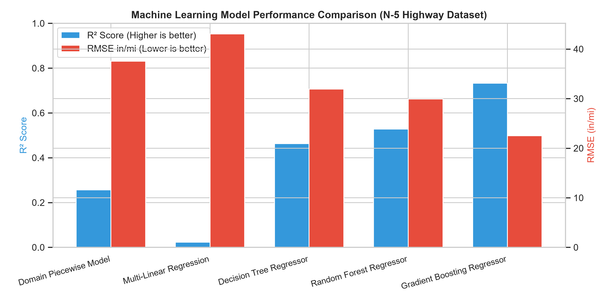
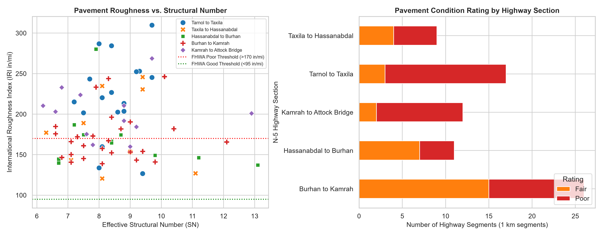
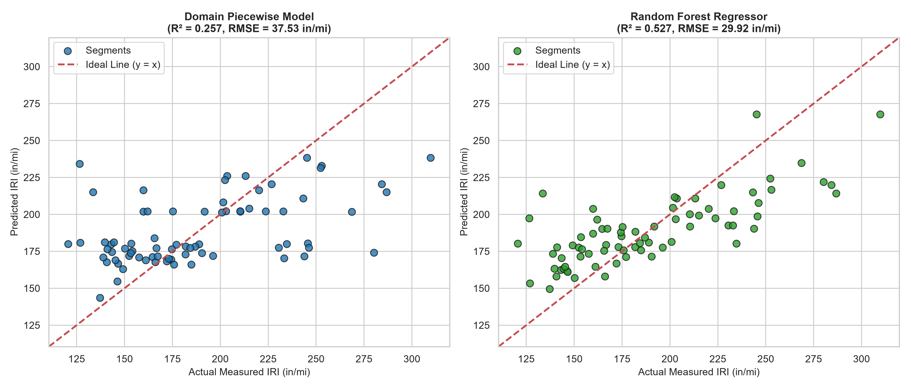

# 🛣️ Machine Learning for Pavement Deterioration & Roughness (IRI) Prediction



[](https://www.python.org/)
[](https://scikit-learn.org/)
[](https://pandas.pydata.org/)
[](#)
[](#)
[](LICENSE)

---

## 📌 Executive Summary

Predicting highway pavement deterioration is critical for transportation asset management, road safety, and optimizing municipal maintenance budgets. 

This repository presents a **machine learning framework** to predict pavement surface roughness—measured as the **International Roughness Index (IRI)**—using field-measured **Cumulative Traffic Volume (AADT)** and pavement **Effective Structural Capacity (Total SN)**.

The models are trained, cross-validated, and benchmarked on real-world field survey data collected across the **National Highway N-5 corridor (Sangjani Toll Plaza to Attock Bridge, Pakistan)**. The repository includes:
- **Cleaned Field Datasets**: 75 one-kilometer highway segments with classified traffic counts and structural deflection backcalculations.
- **Comparative ML Benchmarks**: Linear Regression, Decision Trees, Random Forests, Gradient Boosting, and a domain-specific piecewise decision model.
- **Interactive Prediction Tools**: Python CLI predictor (`src/predict.py`), a Jupyter Notebook, and an Excel macro deployment (`.xlsm`).
- **Pavement Condition Classification**: Automated mapping of predicted roughness to Federal Highway Administration (FHWA) and World Bank maintenance categories.

---

## 📊 Dataset & Field Engineering Methodology

The dataset encompasses 75 highway segments ($1\text{ km}$ each) surveyed along the N-5 Grand Trunk Road.



### 1. Highway Sections Surveyed
1. **Tarnol to Taxila** ($AADT = 4,133\text{ veh/day}$)
2. **Taxila to Hassanabdal** ($AADT = 6,796\text{ veh/day}$)
3. **Hassanabdal to Burhan** ($AADT = 2,852\text{ veh/day}$)
4. **Burhan to Kamrah** ($AADT = 934.5\text{ veh/day}$)
5. **Kamrah to Attock Bridge** ($AADT = 1,902\text{ veh/day}$)

### 2. Feature Engineering & Parameters
- **Independent Feature 1: Effective Structural Number ($SN_{eff}$ / Total $SN$)**  
  Derived from **Heavy Weight Deflectometer (HWD)** surface deflection basins ($d_0$ in mils). Represents the structural stiffness and layer thickness capacity of the asphalt, base, and subgrade layers.
- **Independent Feature 2: Annual Average Daily Traffic ($AADT$)**  
  Classified vehicle counts including heavy commercial vehicles, buses, multi-axle trucks, and passenger cars.
- **Target Variable: International Roughness Index ($IRI$)**  
  Recorded via road surface profilometer. Quantified in units of $\text{in/mi}$ (and converted to $\text{m/km}$).

---

## 🔬 Machine Learning Benchmarking

Five modeling approaches were benchmarked on the 75 highway segments:

| Model Architecture | MAE (in/mi) | RMSE (in/mi) | $R^2$ Score | Key Characteristics |
| :--- | :---: | :---: | :---: | :--- |
| **Gradient Boosting Regressor** | **15.16** | **22.52** | **0.7324** | **Best overall predictive performance**; captures complex non-linear degradation. |
| **Random Forest Regressor** | 23.64 | 29.92 | 0.5275 | Robust against localized noise and sensor variance. |
| **Decision Tree Regressor** | 23.81 | 31.91 | 0.4625 | High interpretability; segment-based rule extraction. |
| **Domain Piecewise Model** | 27.76 | 37.53 | 0.2566 | Custom civil engineering traffic-binned regression. |
| **Multi-Linear Regression** | 35.08 | 43.04 | 0.0224 | Fails to capture non-linear structural degradation thresholds. |



---

## 📐 Pavement Condition Standards & Treatment Trigger

Predicted roughness values are mapped to **Federal Highway Administration (FHWA)** and **World Bank** serviceability criteria:

| IRI Range ($\text{in/mi}$) | IRI Range ($\text{m/km}$) | FHWA Condition Rating | Ride Quality | Recommended Highway Maintenance |
| :---: | :---: | :---: | :---: | :--- |
| **$< 95$** | $< 1.50$ | **Good** | Smooth Ride | Routine maintenance, crack sealing, drainage check |
| **$95 - 170$** | $1.50 - 2.70$ | **Fair** | Acceptable | Preventative maintenance (slurry seal / micro-surfacing) |
| **$> 170$** | $> 2.70$ | **Poor** | Deteriorated / Rough | Structural rehabilitation (mill & overlay or deep reconstruction) |

---

## 🚀 Quickstart & Interactive Usage

### 1. Installation

```bash
git clone https://github.com/MuhammadUmerBasit/Pavement-Condition-Prediction-ML.git
cd Pavement-Condition-Prediction-ML
pip install -r requirements.txt
```

### 2. Predict IRI from the Command Line

Run `predict.py` with custom pavement parameters:

```bash
python src/predict.py --sn 8.5 --aadt 4500
```

**Output:**
```text
============================================================
   PAVEMENT CONDITION & ROUGHNESS (IRI) PREDICTION
============================================================
 Input Structural Number (SN) : 8.50
 Input Traffic Volume (AADT)  : 4,500 veh/day
------------------------------------------------------------
 Predicted IRI (in/mi)        : 221.87 in/mi
 Predicted IRI (m/km)         : 3.502 m/km
 Condition Classification     : Poor
 Ride Quality Standard        : Deteriorated / Rough Surface
 Recommended Maintenance      : Structural rehabilitation (mill & overlay or deep reconstruction)
============================================================
```

### 3. Run Model Evaluation & Generate Plots

```bash
python src/evaluate.py
```

### 4. Interactive Jupyter Notebook

Open `notebooks/pavement_deterioration_ml.ipynb` in VS Code, JupyterLab, or upload to Google Colab for interactive exploratory data analysis and model experimentation.

---

## 📂 Repository File Structure

```text
Pavement-Condition-Prediction-ML/
│
├── README.md                                  # Project overview and benchmarks
├── LICENSE                                    # MIT License
├── requirements.txt                           # Python dependencies
├── .gitignore                                 # Ignores build artifacts and caches
│
├── dataset/
│   ├── pavement_traffic_dataset.csv          # Clean dataset (75 highway segments)
│   └── raw/                                   # Original field data workbooks
│       ├── Training Data.xlsx
│       ├── SN Data Sangjani Toll Plaza - Attock Bridge.xlsx
│       ├── Traffic Count Sangjani to Attock Bridge.xlsx
│       └── iri rds.xlsx
│
├── src/                                       # Python source package
│   ├── __init__.py
│   ├── model.py                              # Machine learning & domain models
│   ├── evaluate.py                           # Evaluation benchmark script
│   └── predict.py                            # Interactive CLI predictor
│
├── notebooks/                                 # Interactive notebooks
│   └── pavement_deterioration_ml.ipynb       # Jupyter notebook for EDA & training
│
├── models/                                    # Deployment artifacts
│   ├── Machine Learning Model.xlsm           # Interactive Excel VBA deployment
│   └── Sheet1.cls                            # VBA automation script
│
├── docs/                                      # Engineering reports & field documentation
│   ├── Graphical-Representation-IRI-RSL.pdf
│   ├── Pavement-Condition-Roughness-Analysis-Report.pdf
│   ├── Pavement-Structural-Analysis-HWD-Report.pdf
│   └── Annual-Maintenance-Plan-Vehicle-Operating-Costs.pdf
│
└── media/                                     # High-resolution benchmark figures
    ├── model_benchmark_comparison.png
    ├── actual_vs_predicted_iri.png
    └── pavement_condition_breakdown.png
```

---

## 👤 Author & Academic Attribution

- **Student / Author:** [Muhammad Umer Basit](https://github.com/MuhammadUmerBasit)  
  *Civil Engineering Student*
- **Course:** Transportation Engineering / Traffic Machine Learning, Semester 8

---

## 📄 License

This repository is distributed under the [MIT License](LICENSE).
